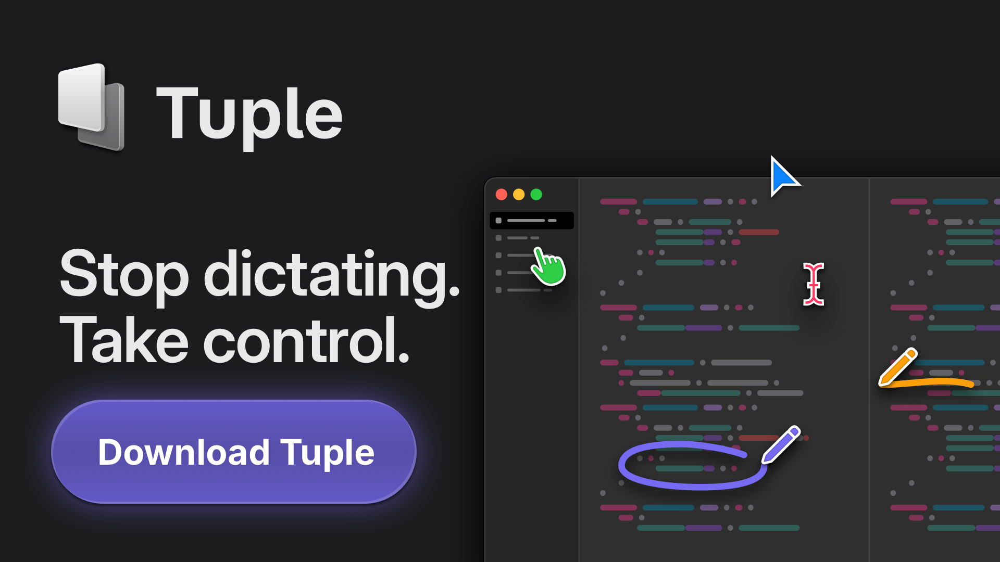

> **语言**：本文档为简体中文翻译，[点此查看英文原版 README.md](README.md)。

<div align="center">
<sup>Special thanks to:</sup>
<br>
<br>
<a href="https://www.warp.dev/?utm_source=github&utm_medium=referral&utm_campaign=lazydocker_20231023">
  <div>
    
  </div>
  <b>Warp, the intelligent terminal</b>
  <br>
  <b>Available for MacOS and Linux</b>
  <br>
  <div>
    <sup>Visit warp.dev to learn more.</sup>
  </div>
</a>
<br>
<hr>
<a href="https://tuple.app/lazydocker">
  <div>
    
  </div>
  <b>Tuple, the premier screen sharing app for developers on macOS and Windows.</b>
</a>
<br>
<hr>
<br>
<a href="https://www.subble.com/jobs/engineer">
  <div>
    
  </div>
  <b>Click here to learn more</b>
</a>
<br>

<hr>
</div>

<p align="center">
  
</p>

一款用 Go 和 [gocui](https://github.com/jroimartin/gocui 'gocui') 库编写的、同时面向 docker 和 docker-compose 的简易终端 UI。


[](https://goreportcard.com/report/github.com/jesseduffield/lazydocker)
[](https://golangci.com)
[](http://godoc.org/github.com/jesseduffield/lazydocker)

[](https://github.com/jesseduffield/lazydocker/releases)
[](https://github.com/jesseduffield/lazydocker/releases/latest)
[](https://github.com/Homebrew/homebrew-core/blob/master/Formula/lazydocker.rb)


[演示视频](https://youtu.be/NICqQPxwJWw)

## 赞助者

<p align="center">
 本项目的维护离不开所有<a href="https://github.com/jesseduffield/lazydocker/graphs/contributors">贡献者</a>与<a href="https://github.com/sponsors/jesseduffield">赞助者</a>的支持。如果你想赞助本项目，并让你的头像或公司 logo 出现在下方，请<a href="https://github.com/sponsors/jesseduffield">点击这里</a>。 💙
</p>

<p align="center">
<!-- sponsors --><a href="https://github.com/intabulas"></a><a href="https://github.com/peppy"></a><a href="https://github.com/piot"></a><a href="https://github.com/rgwood"></a><a href="https://github.com/oliverguenther"></a><a href="https://github.com/pawanjay176"></a><a href="https://github.com/bdach"></a><a href="https://github.com/davidklsn"></a><a href="https://github.com/carstengehling"></a><a href="https://github.com/ceuk"></a><a href="https://github.com/akospwc"></a><a href="https://github.com/Xetera"></a><a href="https://github.com/HoldenLucas"></a><a href="https://github.com/nartc"></a><a href="https://github.com/matejcik"></a><a href="https://github.com/lucatume"></a><a href="https://github.com/IvanZuy"></a><a href="https://github.com/nicholascloud"></a><a href="https://github.com/PhotonQuantum"></a><a href="https://github.com/GitSquared"></a><a href="https://github.com/ava1ar"></a><a href="https://github.com/minidfx"></a><a href="https://github.com/JoeKlemmer"></a><a href="https://github.com/tobi"></a><a href="https://github.com/benbfortis"></a><a href="https://github.com/jakewarren"></a><a href="https://github.com/tgpholly"></a><a href="https://github.com/jisantuc"></a><a href="https://github.com/bitprophet"></a><a href="https://github.com/tayleighr"></a><a href="https://github.com/Novakov"></a><a href="https://github.com/farzadmf"></a><a href="https://github.com/nekhaevskiy"></a><a href="https://github.com/reivilibre"></a><a href="https://github.com/andreaskurth"></a><a href="https://github.com/BSteffaniak"></a><a href="https://github.com/jordan-gillard"></a><a href="https://github.com/smangels"></a><a href="https://github.com/George-Spanos"></a><a href="https://github.com/frantisekstanko"></a><a href="https://github.com/amslezak"></a><a href="https://github.com/mkock"></a><a href="https://github.com/illarionvk"></a><a href="https://github.com/WhiteBlackGoose"></a><a href="https://github.com/jessealama"></a><a href="https://github.com/codacy"></a><a href="https://github.com/colbr"></a><a href="https://github.com/heijmans"></a><a href="https://github.com/Vesther"></a><a href="https://github.com/sempruijs"></a><a href="https://github.com/omarluq"></a><a href="https://github.com/ethanjli"></a><a href="https://github.com/phubaba"></a><a href="https://github.com/fomrat"></a><a href="https://github.com/canhazcodez"></a><a href="https://github.com/nikbrunner"></a><a href="https://github.com/neunkasulle"></a><a href="https://github.com/ahkohd"></a><a href="https://github.com/RVxLab"></a><a href="https://github.com/igor-ramazanov"></a><a href="https://github.com/glotchimo"></a><a href="https://github.com/n8nio"></a><a href="https://github.com/kaleballmon"></a><a href="https://github.com/joshuadavidthomas"></a><a href="https://github.com/josephjacks"></a><a href="https://github.com/FrederickGeek8"></a><a href="https://github.com/agrippanux"></a><a href="https://github.com/ezdac"></a><a href="https://github.com/sarzhann"></a><a href="https://github.com/dbuls"></a><a href="https://github.com/MGreek"></a><a href="https://github.com/sainu"></a><a href="https://github.com/mguellsegarra"></a><a href="https://github.com/lppassos"></a><a href="https://github.com/chrisolsen"></a><a href="https://github.com/vladimir-popov"></a><a href="https://github.com/neilcode"></a><a href="https://github.com/shaungarwood"></a><a href="https://github.com/dhh"></a><a href="https://github.com/wayanjimmy"></a><!-- sponsors -->
</p>

## 一分钟简介

前方轻度吐槽预警：有什么东西不工作了？也许是某个服务挂了。`docker-compose ps`。果然是那个一直有 bug 的微服务。没关系，我重启一下它：`docker-compose restart`。好，现在再试一次。噢等等，问题还在。嗯。`docker-compose ps`。看来这个服务肯定是一启动就立刻停掉了。如果我一直在看日志流的话，本来是能发现的，但日志里混杂着其他服务的大量杂音。我倒是可以用 `docker compose logs --follow myservice` 只看这个服务的日志，但只要服务一挂这个命令也会死掉，就得每次服务重启后都重新运行一次。或者我可以运行 `docker-compose up myservice`，这样在这个终端窗口里，如果服务停了，我可以直接再 `up` 一次，可现在即使我已经不关心它的日志了，这个服务仍然霸占着一个终端窗口。我想当我想收回这块终端"地产"时，可以按 `ctrl+P,Q`，但……等等，这不知为何又不工作了。我该改按 ctrl+C 吗？我记不清它到底是关闭前台进程还是杀掉真正的服务了。

真是令人头大！

记 docker 命令很难，记别名稍微容易一点点。跨多个终端窗口跟踪你的容器则几乎不可能。要是你能在一个终端窗口里看到所需的全部信息，并且所有常用命令都只需按一个键（还能添加自定义命令）就好了。Lazydocker 的目标就是让这个梦想成真。

- [环境要求](https://github.com/jesseduffield/lazydocker#requirements)
- [安装](https://github.com/jesseduffield/lazydocker#installation)
- [用法](https://github.com/jesseduffield/lazydocker#usage)
- [快捷键](/docs/keybindings)
- [酷炫特性](https://github.com/jesseduffield/lazydocker#cool-features)
- [贡献](https://github.com/jesseduffield/lazydocker#contributing)
- [视频教程](https://youtu.be/NICqQPxwJWw)
- [配置文档](/docs/Config.md)
- [Twitch 直播](https://www.twitch.tv/jesseduffield)
- [常见问题](https://github.com/jesseduffield/lazydocker#faq)

## 环境要求

- Docker >= **29.0.0**（API >= **1.24**）
- Docker-Compose >= **1.23.2**（可选）

## 安装

### Homebrew

通常 `lazydocker` 的 formula 在 Homebrew core 中就有，但我们建议你 tap 我们自己的 formula 以获得更新更频繁的包。它在 Linux 上同样适用。

**Tap**：
```sh
brew install jesseduffield/lazydocker/lazydocker
```

**Core**：
```sh
brew install lazydocker
```

### Scoop（Windows）

你可以使用 [scoop](https://scoop.sh/) 安装 `lazydocker`：

```sh
scoop install lazydocker
```
### Chocolatey（Windows）

你可以使用 [Chocolatey](https://chocolatey.org/) 安装 `lazydocker`：

```sh
choco install lazydocker
```
### asdf-vm

你可以使用 [asdf-vm](https://asdf-vm.com/) 安装 [asdf-lazydocker 插件](https://github.com/comdotlinux/asdf-lazydocker)：
#### 设置（仅一次）
```sh
asdf plugin add lazydocker https://github.com/comdotlinux/asdf-lazydocker.git
```

#### 安装 / 升级
```sh
asdf list all lazydocker
asdf install lazydocker latest
asdf global lazydocker latest
```

### 二进制发布版（Linux/OSX/Windows）

你可以从[发布页面](https://github.com/jesseduffield/lazydocker/releases)手动下载二进制发布版。

自动安装/更新，但别忘了随时核实你正通过管道喂给 bash 的内容：

```sh
curl https://raw.githubusercontent.com/jesseduffield/lazydocker/master/scripts/install_update_linux.sh | bash
```
该脚本默认把下载好的二进制安装到 `$HOME/.local/bin` 目录，但可通过设置 `DIR` 环境变量来更改。

### Go

要求 Go 版本 >= **1.19**

```sh
go install github.com/jesseduffield/lazydocker@latest
```

要求 Go 版本 >= **1.8**，<= **1.17**

```sh
go get github.com/jesseduffield/lazydocker
```

### Arch Linux AUR

你可以通过运行以下命令使用 [AUR](https://aur.archlinux.org/packages/lazydocker) 安装 lazydocker：

```sh
yay -S lazydocker
```

### Docker

[](https://hub.docker.com/r/lazyteam/lazydocker)
[](https://hub.docker.com/r/lazyteam/lazydocker)
[](https://hub.docker.com/r/lazyteam/lazydocker)

1. <details><summary>如果你使用 ARM 设备请点此</summary><p>

    - 如果你的设备是 ARM 32 位 v6 架构

        ```sh
        docker build -t lazyteam/lazydocker \
        --build-arg BASE_IMAGE_BUILDER=arm32v6/golang \
        --build-arg GOARCH=arm \
        --build-arg GOARM=6 \
        https://github.com/jesseduffield/lazydocker.git
        ```

    - 如果你的设备是 ARM 32 位 v7 架构

        ```sh
        docker build -t lazyteam/lazydocker \
        --build-arg BASE_IMAGE_BUILDER=arm32v7/golang \
        --build-arg GOARCH=arm \
        --build-arg GOARM=7 \
        https://github.com/jesseduffield/lazydocker.git
        ```

    - 如果你的设备是 ARM 64 位 v8 架构

        ```sh
        docker build -t lazyteam/lazydocker \
        --build-arg BASE_IMAGE_BUILDER=arm64v8/golang \
        --build-arg GOARCH=arm64 \
        https://github.com/jesseduffield/lazydocker.git
        ```

    </p></details>

1. 运行容器

    ```sh
    docker run --rm -it -v \
    /var/run/docker.sock:/var/run/docker.sock \
    -v /yourpath:/.config/jesseduffield/lazydocker \
    lazyteam/lazydocker
    ```

    - 别忘了把 `/yourpath` 换成你实际创建的、用于存放 lazydocker 配置的路径
    - 你也可以使用这份 [docker-compose.yml](https://github.com/jesseduffield/lazydocker/blob/master/docker-compose.yml)
    - 你可能想创建一个别名，例如：

        ```sh
        echo "alias lzd='docker run --rm -it -v /var/run/docker.sock:/var/run/docker.sock -v /yourpath/config:/.config/jesseduffield/lazydocker lazyteam/lazydocker'" >> ~/.zshrc
        ```


对于开发场景，你可以用以下命令构建镜像：

```sh
git clone https://github.com/jesseduffield/lazydocker.git
cd lazydocker
docker build -t lazyteam/lazydocker \
    --build-arg BUILD_DATE=`date -u +"%Y-%m-%dT%H:%M:%SZ"` \
    --build-arg VCS_REF=`git rev-parse --short HEAD` \
    --build-arg VERSION=`git describe --abbrev=0 --tag` \
    .
```

如果你遇到与 Docker 内置二进制相关的兼容性问题，可尝试在构建时加上参数 `--build-arg DOCKER_VERSION="v$(docker -v | cut -d" " -f3 | rev | cut -c 2- | rev)"`
重新构建镜像，
使内置的 docker 二进制与宿主机的 docker 二进制版本一致。

### 手动

你需要[安装 Go](https://golang.org/doc/install)

```
git clone https://github.com/jesseduffield/lazydocker.git
cd lazydocker
go install
```

你也可以用 `go run main.go` 一步完成编译并运行（这个 "one go" 双关语绝对是故意的）

## 用法

在终端里调用 `lazydocker` 即可。我个人非常频繁地使用它，所以给它建了个这样的别名：

```
echo "alias lzd='lazydocker'" >> ~/.zshrc
```

（你可以把 .zshrc 换成你正在使用的任何 rc 文件）

- 基础视频教程在[这里](https://youtu.be/NICqQPxwJWw)。
- 快捷键列表在
[这里](/docs/keybindings)。

## 酷炫特性

一切只需按一个键（或者点一下鼠标！鼠标支持就是牛）：

- 纵览 docker 或 docker-compose 容器环境的当前状态
- 查看某个容器/服务的日志
- 以 ascii 图表查看容器的指标——不仅要有开发者的手感，还要有开发者的排面
- 自定义这些图表，度量你几乎想要的任何指标
- 附加（attach）到某个容器/服务
- 重启/移除/重建容器/服务
- 查看某个镜像的祖先层
- 清理（prune）那些狂占磁盘空间的容器、镜像或卷

## 贡献

还有大量工作等着做！请阅读[贡献指南](CONTRIBUTING.md)。
有些话题在这里（仓库中）讨论不如在别处讨论，欢迎加入 discord 频道

<a href="https://discord.gg/ehwFt2t4wt"></a>

## 捐赠

如果你想支持 lazydocker 的开发，可以考虑[赞助我](https://github.com/sponsors/jesseduffield)（GitHub 将在 12 个月内对所有捐赠按 1:1 等额配比）

## 社交

如果你想看我（Jesse）在开发上的最新动态，可以在
[twitter](https://twitter.com/DuffieldJesse) 上关注我，或者到
[twitch](https://www.twitch.tv/jesseduffield) 上看我写代码

## 常见问题

### 如何编辑配置？

打开 lazydocker，点击左上角的 'project' 面板，然后按下 'o'（如果你的编辑器是 vim 就按 'e'）。参见[配置文档](/docs/Config.md)

### 如何让主面板中的文本自动换行？

将来我想把换行设为默认行为，但目前换行会引发一些 CPU 问题。如果你想启用换行，请使用 `gui.wrapMainPanel: true`

### 如何选择文本？

因为我们支持鼠标事件，你需要在拖动鼠标的同时按住 option 键，以表明你是想选择文本而不是点击某个东西。或者，你也可以通过 `gui.ignoreMouseEvents` 配置项禁用鼠标事件。

Mac 用户：其他方案参见 [Issue #190](https://github.com/jesseduffield/lazydocker/issues/190)。

### 为什么我看不到容器的日志？

默认我们只显示最近一小时的日志，以免给机器带来太大负担。这可能就是你刚启动 lazydocker 时看不到日志的原因。这一行为可以在配置的 `commandTemplates` 中覆盖

如果你是在 Docker 容器里运行 lazydocker，这是一个已知 bug：看不到日志或 CPU 使用率。

## 同类替代品

- [docui](https://github.com/skanehira/docui) - Skanehira 抢在我前面做出了一个 docker 终端 UI，所以也一定去看看那个仓库！不过我认为这两个仓库可以和谐共存：lazydocker 更侧重于管理现有的容器/服务，而 docui 更侧重于创建和配置它们。
- [Portainer](https://github.com/portainer/portainer) - Portainer 试图解决同样的问题，但它是通过浏览器而非终端访问的。它还支持 docker swarm。
- 类似工具可以查看 [Awesome Docker 列表](https://github.com/veggiemonk/awesome-docker/blob/master/README.md#terminal) 中与 Docker 相关的部分。
